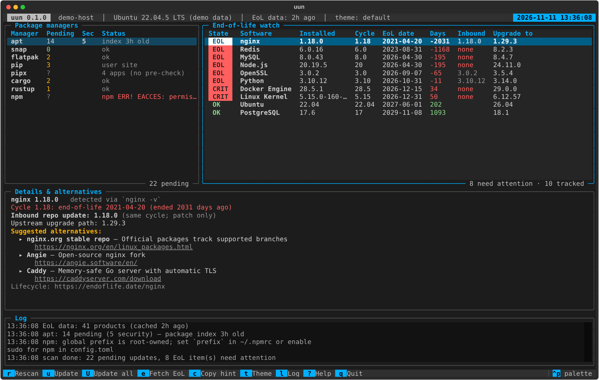
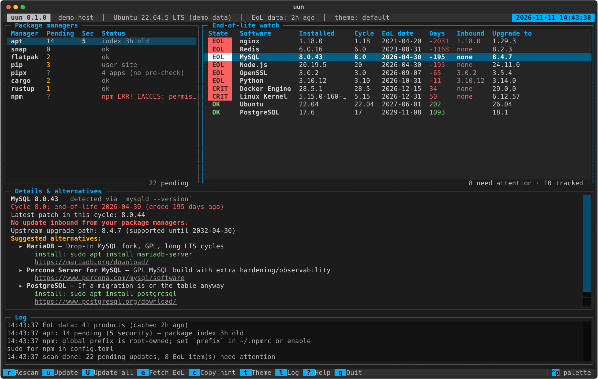
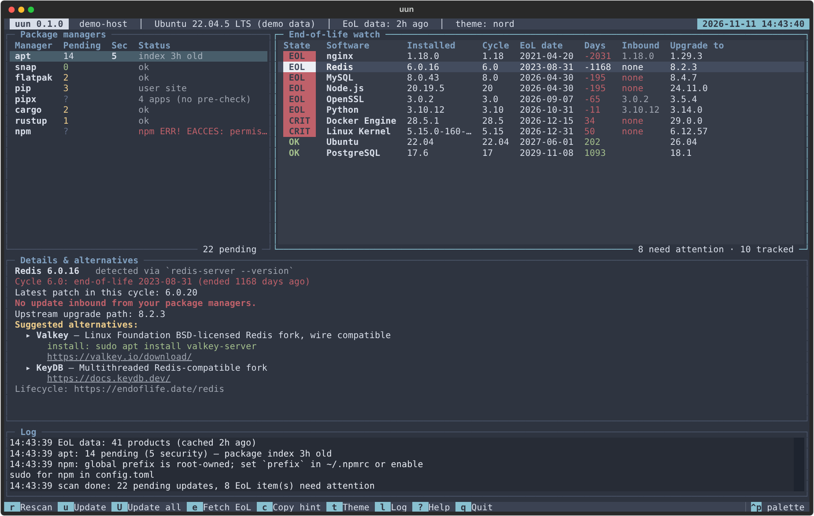
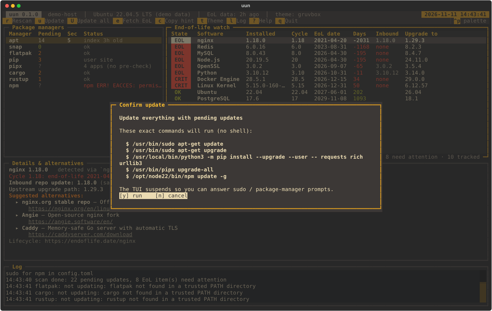
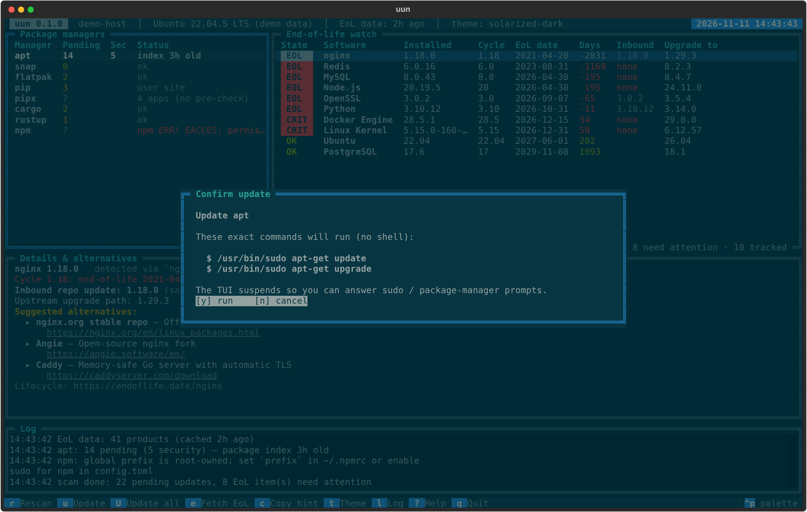
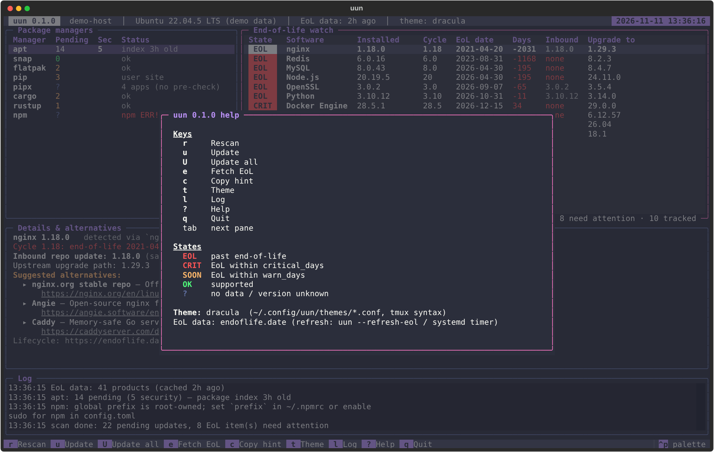
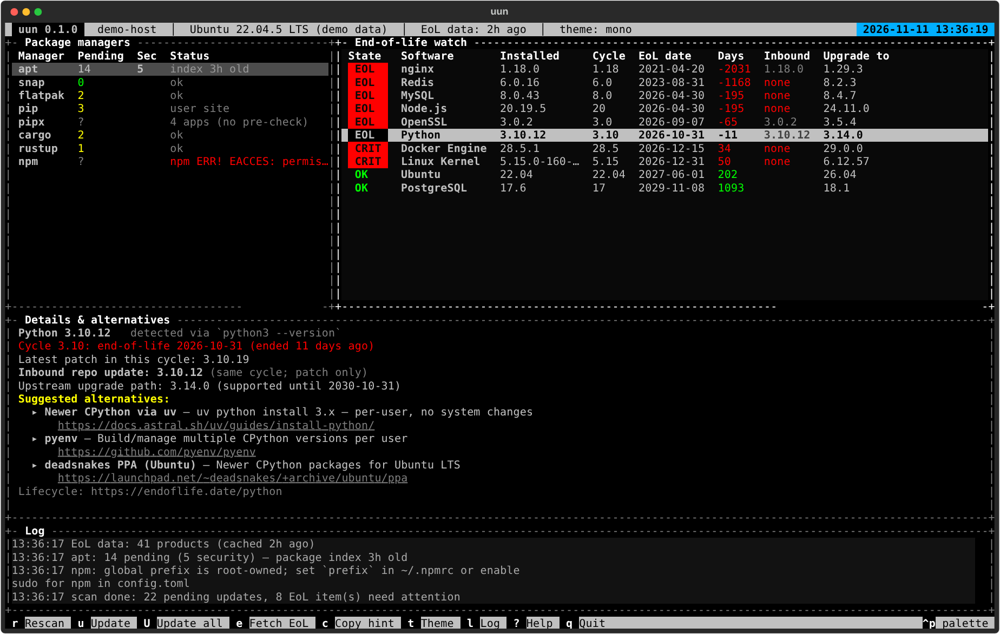

# uun — universal update notifier

A terminal UI that, in one screen:

1. **Updates everything repo-based**: apt, dnf/yum, zypper, pacman, flatpak, snap, Homebrew, pip (user/venv), pipx, cargo (via `cargo-update`), rustup, npm global.
2. **Tracks end-of-life dates** for your OS, kernel, language runtimes, databases and servers, using the open [endoflife.date](https://endoflife.date) API. A systemd user timer (or cron) refreshes the data daily.
3. **Lists upcoming EoLs**, sorted by urgency: `EOL` → `CRIT` → `SOON` → `OK`.
4. **Suggests alternatives** when something is EoL or close to it **and no supported version is coming from your package managers** (for example MySQL → MariaDB / Percona / PostgreSQL, Redis → Valkey, CentOS → Rocky / Alma, Terraform → OpenTofu). It also shows the upstream upgrade path.
5. **Live clock** in the upper-right corner (ISO 8601 date + `hh:mm:ss`, updated every second; format and colours themable).
6. **Themes in tmux syntax**: `set -g status-style "bg=colour235,fg=colour250"`, `pane-border-lines`, `source-file`, `bind-key`, `@user-options`.

It's built entirely on open-source software: Python ≥ 3.11 and [Textual](https://github.com/Textualize/textual) (MIT) for the TUI. uun itself is MIT-licensed.



<details><summary>More previews (demo data)</summary>

| | |
|---|---|
|  |  |
|  |  |
|  |  |

</details>

## Install

**Packages (recommended).** Download from [Releases](https://github.com/nc-intezra/uun/releases), check the file against `SHA256SUMS`, then install:

```bash
sha256sum -c SHA256SUMS --ignore-missing
# Ubuntu 24.04+, Debian 12+, Raspberry Pi OS (bookworm+, arm64/armhf)
sudo apt install ./uun_0.1.1-1_all.deb
# Fedora, RHEL/Rocky/Alma 9 (pulls in python3.11+ automatically)
sudo dnf install ./uun-0.1.1-1.noarch.rpm
# openSUSE Leap 15.6
sudo zypper install --allow-unsigned-rpm ./uun-0.1.1-1.noarch.rpm

systemctl --user enable --now uun-eol-refresh.timer   # daily EoL refresh: as YOUR user, no sudo
uun --demo                                            # safe preview
```

The refresh timer is a **per-user** systemd unit. Run `systemctl --user` as your normal user: with `sudo` it talks to root's (non-existent) session and fails with `Failed to connect to bus`. On servers without a desktop login, also run `sudo loginctl enable-linger $USER` once so the timer runs while you're logged out. To turn it on for every user at their next login instead, use `sudo systemctl --global enable uun-eol-refresh.timer`.

Both packages are architecture-independent and bundle their pure-Python dependencies in `/usr/lib/uun`. They need Python 3.11 or newer, from the distro's default `python3` or a parallel `python3.11`/`python3.12` package. The `/usr/bin/uun` launcher only uses interpreters in `/usr/bin` and runs them isolated (`python -I`).

**From source:**

```bash
./install.sh            # pipx (or a private venv) + daily EoL refresh timer
```

**Building packages:** `packaging/build.sh <source-dir> <out-dir>` produces reproducible wheel, sdist, `.deb` and `.rpm` files plus `SHA256SUMS`. The `release` GitHub Actions workflow builds them for a tag, install-tests them on Ubuntu, Debian, Raspberry Pi (arm64/armhf), Rocky, Alma, Fedora and openSUSE, and attaches them to the release.

## Keys

| key | action | | key | action |
|---|---|---|---|---|
| `r` | rescan | | `c` | copy install hint / URL (OSC 52) |
| `u` | update selected manager | | `t` | cycle themes live |
| `U` | update all managers with pending updates | | `l` | toggle log |
| `e` | force EoL data refresh | | `?` | help |
| `tab` | switch pane | | `q` | quit |

Before an update runs, you see the **exact argv** of every command and confirm with `y`. The TUI then suspends so you can answer sudo and package-manager prompts, and it rescans when you return.

## How "no update inbound" is decided

For each detected product, uun:
1. Matches the installed version to an endoflife.date release cycle (longest prefix, e.g. `5.15.0-160-generic` → `5.15`).
2. Looks for a pending package-manager update for that product's packages (`packages` globs in `products.toml`, e.g. `mysql-server*`).
3. Counts the update as a **fix** only if the pending version lands in a cycle that is still supported beyond `warn_days`. A patch inside a dead cycle doesn't count.
4. If the product is `EOL`/`CRIT`/`SOON` and no fix is inbound, it shows the alternatives from `alternatives.toml` with distro-specific install hints. **It never installs alternatives itself**, because they usually need a data migration.

## Configuration (`~/.config/uun/`)

| file | purpose |
|---|---|
| `config.toml` | theme, `warn_days` (180), `critical_days` (60), cache age, per-manager enable + update commands |
| `products.toml` | what to probe (copy from `uun/data/` to extend: slug, argv, version regex, package globs) |
| `alternatives.toml` | your own alternative suggestions |
| `themes/*.conf` | tmux-syntax themes |

Update commands are argv lists (never a shell). `@SUDO` expands to `sudo` only when you're not root:

```toml
[managers.apt]
update = [["@SUDO", "apt-get", "update"], ["@SUDO", "apt-get", "dist-upgrade"]]
[managers.snap]
enabled = false
```

## Theming (tmux syntax)

```tmux
# ~/.config/uun/themes/mine.conf
source-file nord.conf                     # inherit, like tmux
set -g @textual-base nord                 # any Textual built-in as a base
set -g status-style "bg=colour236,fg=colour250"
set -g @status-key-style "bg=colour39,fg=colour16"
set -g status-position top                # key bar on top
set -g pane-border-style "fg=colour240"
set -g pane-active-border-style "fg=colour39"
set -g pane-border-lines heavy            # single|double|heavy|rounded|simple
set -g mode-style "bg=colour24,fg=colour231"   # selected row
set -g message-style "bg=colour233,fg=colour248"  # log pane
set -g @eol-critical colour203
set -g @eol-warning  colour214
set -g @eol-ok       colour114
set -g @clock-format "%Y-%m-%d %H:%M:%S"  # upper-right live clock (strftime, like status-right)
set -g @clock-style "bg=colour39,fg=colour16"
bind-key R refresh                        # actions: refresh update update-all refresh-eol
unbind-key q                              #   copy next-theme toggle-log help quit
```

Colours: `colour0–255`, `#rrggbb`, and tmux names (`red`, `brightblue`, …). Bundled themes: `default`, `nord`, `gruvbox`, `solarized-dark`, `dracula`, `mono` (16 colours).

## Headless / cron / CI

```bash
uun --refresh-eol           # what the timer runs
uun --report                # plain text; exit 0 ok, 1 attention, 2 something is EoL
uun --report --json         # for monitoring pipelines
```

## Offline EoL data

A signed monthly snapshot of endoflife.date is published as release `eol-YYYY-MM` for machines without internet access. See [docs/eol-data.md](docs/eol-data.md) for how to verify a bundle and how the monthly pipeline works.

## Security notes

See [SECURITY.md](SECURITY.md) for the full pre-release audit (CVSS-scored findings and fixes). In short:

- Config files that define sudo commands are read only after their open file descriptor and every parent directory pass owner and permission checks.
- Executables resolve only from trusted `PATH` directories. `sudo` must be a root-owned setuid binary. The confirmation dialog shows the exact absolute paths that will run, with no shell.
- Every child process runs with `cwd=/`, so a hostile checkout you launch uun from can't inject code or tool config.
- EoL data is fetched over HTTPS only (no redirect downgrades, 2 MB / 45 s limits) and strictly validated. Anything shown in the TUI or printed is stripped of control and bidi characters and rendered as literal text, never markup.
- pip touches only the active virtualenv or `--user`, never system site-packages (PEP 668).
- The systemd refresh unit is sandboxed.

## Tests

```bash
python3 -m unittest discover -s tests   # logic + security regression tests
python3 tests/shots.py                  # regenerate demo screenshots (SVG)
```
